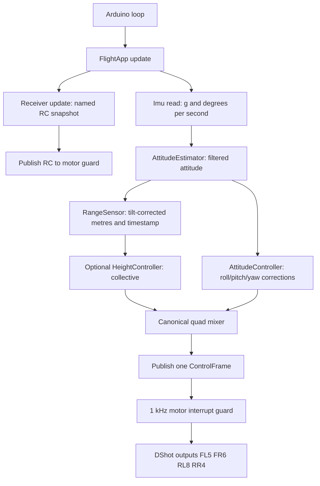

# Learning the modular firmware, from entry point to your own packages

If this is your first substantial C++ program, begin with `START_HERE.md` and the numbered comments in `FlightApp.cpp`. This longer document explains the design after you have followed the main sequence once.

## 1. The decision process

The previous application worked through shared variables such as `channel_1_pwm`, `roll_IMU`, `thro_des` and `m1_command_scaled`. A function could change a variable another function used without that dependency appearing in either function's interface. Unused functionality also made it hard to see the active path.

The first design decision was **preserve the active behavior before changing the control design**. The new application keeps the same four output modes, controller gains, axis conventions, motor wiring, height/landing logic, timing targets and fault-stop policies. It removes unused alternatives from the application. It does not claim a new flight tune or a complete air/boat mode manager.

The second decision was **choose boundaries around responsibilities, not file length**:

- Devices know how to talk to hardware.
- Control code knows how to transform measurements and targets into commands.
- Safety code decides whether commands may reach actuators.
- The application owns the objects and schedules their work.

The third decision was **prefer concrete classes and small data records**. There is no plugin registry, inheritance hierarchy, runtime allocation, RTOS or generic dependency-injection framework. Those would make this first learning version harder to trace. A reusable library is demonstrated separately without inserting new filtering into the aircraft.

## 2. Read the program in this order

1. `ITC_Firmware.ino`: only the Arduino entry points.
2. `Config.h`: assumptions and settings.
3. `Types.h`: the data that flows between modules.
4. `FlightApp.cpp`: startup order and each control-cycle step.
5. The public interfaces in `Receiver.h`, `Sensors.h`, `Control.h` and `Motors.h`.
6. Their `.cpp` implementations, one responsibility at a time.
7. `HeightController.h` and `SafetyLogic.h`: their state machines and timing checks.
8. The low-level driver code in `src/` after the application interfaces make sense.

You do not need to understand every quaternion equation or DMA register to understand the application pipeline. You do need to understand their input/output contracts, units and failure limitations.

## 3. What .h, .cpp, include and namespace mean here

A **header** (`.h`) declares what another module can use: types, classes and function signatures. A **source file** (`.cpp`) supplies the implementation. `#include "Control.h"` lets the compiler see those declarations; it does not mean you should include `Control.cpp` too. Arduino compiles the sketch's source files and the linker combines them.

`#pragma once` prevents the same header being expanded repeatedly in one compilation unit. It does not create a global variable or share object state.

`namespace itc` groups project names. `itc::FlightApp` identifies the project class unambiguously. Settings live in `itc::config`, so `config::HEIGHT_KP` is a named setting rather than a mutable global controller variable.

The `.ino` is intentionally small. Ordinary `.cpp` code requires declarations from headers instead of depending on Arduino's automatic generation of function prototypes. That makes dependencies explicit and lets the math compile outside Arduino.

`HeightController.h` and `SafetyLogic.h` are intentionally header-only. Functions defined inside a class are implicitly `inline`; the free helper functions are marked `inline` or `constexpr`. Here `inline` allows those definitions to appear through a header in multiple compilation units; it does not force the compiler to expand every call. An ordinary non-inline function body placed in a shared header can instead cause multiple-definition linker errors. As a module grows, putting its implementation in one `.cpp` is usually clearer.

## 4. Objects own memory; records carry data

Consider these three forms:

```cpp
itc::Imu imu;                    // Object: owns a hardware driver.
itc::ImuSample sample = imu.read(); // Record: one set of measurements.
itc::AttitudeEstimator estimator; // Object: owns filter/quaternion memory.
const auto& attitude = estimator.update(sample, dt);
```

The IMU object owns the MPU driver. The estimator owns filter history and its quaternion. The attitude controller owns its integral terms. The height controller owns its target ramp, speed estimate, integral and landing state. They do not need unrelated variables from another source file.

`private` members belong to an object's implementation. Callers use its `public` interface. A trailing underscore such as `integralRoll_` is a naming convention for a member, not special C++ syntax.

A `const T&` parameter means “read this existing object without copying or modifying it.” A returned reference such as `RangeSensor::state()` refers to that sensor object's storage: the next update can change it. In contrast, `RcState` and `MotorStatus` are returned by value to give the caller a snapshot. Do not store references beyond the owning object's lifetime.

An object such as `HeightController` still exposes diagnostic state for the preview/console; that is a conscious small-project tradeoff. A later version could expose a separate read-only status record without changing the control algorithm.

The application creates its objects as members and one static `FlightApp` instance. You do not need C++ `new`, pointers to every module or dynamic allocation to build a modular program. A constructor establishes an object's initial state; `begin()` performs hardware startup after Arduino has initialized the board.

## 5. Follow one complete cycle



The receiver is serviced on every loop pass. The remaining work runs when 500 microseconds have elapsed. `FlightApp` reads sensors, runs the selected control path, and publishes the resulting commands and health information together. Telemetry is printed afterward, at a slower rate.

Mode 0 runs height-controller preview but publishes zero motor commands. Mode 1 sends equal limited throttle. Mode 2 uses manual collective and attitude correction. Mode 3 supplies collective from height feedback, then applies the same attitude correction and mixer.

The names `SensorBench`, `Air`, `Boat` etc. could eventually become a more complete mode manager, but the present compile-time values 0–3 are output/test selections, **not** the project's final AIR → TRANSITION → BOAT state machine.

## 6. State the contracts, units and clocks

| Record/interface | Meaning |
|---|---|
| `ImuSample.accelG` | Sensor-axis acceleration in g, bias corrected |
| `ImuSample.gyroDps` | Sensor-axis rate in degrees/second, bias corrected |
| `Attitude` | Degrees plus filtered gyro/acceleration and finite-result validity |
| `RcState` | Named pulse-equivalent channel values and accepted-frame time |
| `Setpoints` | Normalized collective, desired roll/pitch degrees, desired yaw degrees/second |
| `Effort` | Dimensionless mixer corrections |
| `RangeState` | Metres, range status, last accepted-sample timestamp and current validity |
| `MotorCommands` | Four DShot counts, always FL/FR/RL/RR |
| `ControlFrame` | Commands, readiness, range freshness and control heartbeat |

The existing estimator's sensor sign transformation is preserved in `AttitudeEstimator::update()`. The attitude controller uses the same filtered rate axes as before. A refactor is not a reason to change only one axis sign: mounting and corrective directions still require physical verification.

Microsecond timestamps use unsigned 32-bit arithmetic, so elapsed-time comparisons survive counter rollover. Intervals passed to numerical algorithms are in **seconds**, not microseconds. Filters and the height integrator need actual elapsed sample time.

There are two height-validity questions. `RangeState.valid` describes the latest range result; `usableHeight()` allows the last accepted height to be used briefly until the existing 200 ms freshness limit expires. A rejected reading is not integrated as a new measurement. This distinction preserves the previous short-dropout policy.

`Attitude.valid` checks finite estimator output; it is not a comprehensive SPI sensor-health diagnosis. The inherited raw SPI interface cannot prove every returned sample is physically valid. This limitation was not solved by reorganizing files.

## 7. Why motors are a separate module

Writing actuator commands is a special responsibility. `FlightApp` proposes commands; `Motors` has final authority to send or replace them with zero.

The DShot timer interrupt continues independently of the main sensor/control work. Before each frame, it checks receiver validity/age, the control heartbeat, the arming state machine and, in height mode, height readiness/age. It performs no bus reads, logging or controller calculations.

This creates **concurrency**: main-loop code can be interrupted while updating shared data. `volatile` makes accesses visible to the compiler but does not make a group of updates indivisible. Therefore the motor module uses very short interrupt-disabled sections to publish a complete receiver/control record, and restores the caller's previous interrupt state afterward. `status()` similarly copies a consistent output snapshot.

The main loop and the interrupt do not share arbitrary globals anymore. They share a deliberately limited mailbox hidden inside `Motors`.

The CRSF library and DShot library require plain function-pointer callbacks. `Receiver::active_` and `Motors::activeMotorManager_` bridge those callbacks to the owning object. This version intentionally supports one receiver and one motor manager. It is not a general multi-instance callback framework.

## 8. Two explicit fixes found during extraction

**Zero gradient:** the inherited attitude estimator divided by the norm of its correction vector even when that vector was exactly zero. A perfectly level stationary input could then produce `0 * infinity` and corrupt the quaternion with NaN. The new code uses zero correction when the gradient norm is zero. This is tested separately; nondegenerate estimator outputs are compared against the actual old equations.

**Measurement timing:** the old main loop captured `now` before acquisition, while the range layer timestamped its result later. Comparing the later sample time against that earlier `now` with unsigned subtraction makes a fresh measurement appear extremely old. The new application takes freshness-check time **after** acquisition. It still publishes the earlier loop-entry time as its heartbeat, so a stalled sensor read cannot make an old control computation appear fresh.

These are deliberate behavioral corrections. Gains, control laws, output limits and stop/landing policies were not retuned in this refactor. Detailed execution timing can nevertheless change with the new structure, so hardware timing must be rechecked.

## 9. Add your next module in six steps

Suppose you want battery monitoring:

1. Define its responsibility: sample and scale voltage, rather than also commanding motors.
2. Define data: for example `BatteryReading { voltageV, sampledUs, valid }`.
3. Write its public interface in `Battery.h`: typically `begin()` and `update()` or `read()`.
4. Implement device details in `Battery.cpp`. Put calibrated divider settings and timing in `Config.h`; keep ADC/board dependencies out of unrelated control headers.
5. Add a `Battery battery_;` member to `FlightApp`, initialize it in `begin()`, and call it at a documented rate in `update()`. Decide explicitly how to report failure. Adding a motor-stop policy would be a separate control/safety decision, not an automatic consequence of reading voltage.
6. Test scaling/failure handling on the desktop where possible, compile firmware, then validate the actual voltage conversion on hardware.

Do not begin by adding `extern float batteryVoltage` and reading it everywhere: that recreates the coupling this refactor removes. Pass a record to the module that needs it.

If you later add a boat controller, prefer a new control module returning desired surge/yaw actuation and an explicit transition/mode decision in the application. Do not hide an air-to-water transition inside `RangeSensor` or the DShot interrupt.

## 10. Turn a module into a reusable package

See the separate, working `firmware/examples/LearningFilter` folder:

```text
LearningFilter/
  library.properties
  src/
    LearningFilter.h
    LearningFilter.cpp
  examples/
    StepResponse/
      StepResponse.ino
```

`learning::LowPass` takes an input and elapsed time. It owns its memory, depends on no aircraft globals, and can be instantiated twice for two signals. That makes it reusable in firmware or desktop tests. The source is small enough to read in full.

The package has not been installed into shared Arduino libraries or inserted into the flight loop. Its properties file is a local starter; set a real repository URL and appropriate publishing metadata before distributing it. `StepResponse.ino` feeds a simulated input and prints results, with no motor operation.

In the example, `learning::LowPass filter(0.5f);` calls the constructor with a half-second time constant. `filter.update(input, dt)` changes that object's private history. `filter.value()` is marked `const`, so it only reads the current value. `explicit` on the constructor prevents an accidental conversion from an unrelated float into a filter object. The test creates two filters to demonstrate that their histories stay independent.

Once a library is installed in Arduino's library search path, a caller includes `<LearningFilter.h>` and the build system compiles/links its `.cpp` implementation. You include the interface, instantiate the object, and explicitly schedule updates. Copying the entire flight application's `Config.h` into every package would make those packages project-dependent; package-specific settings should instead be constructor parameters or a small package config structure.

Before extracting a project module into a library, ask: “What information would a different application have to provide?” If the answer is “the whole aircraft,” the boundary is probably too broad.

## 11. Verification and useful exercises

The existing height behavior and arming checks run against the new headers. The new estimator is checked against 10,000 old-equation updates, and angle control against 5,000 old-equation updates. Mixer ordering/signs, command limits, freshness and the two specific bug fixes are checked separately. The learning package is tested independently. These tests establish software behavior under their input assumptions, not flight readiness.

Exercises to build understanding, in order:

1. Trace CH3 from `Receiver` to either `Setpoints.collective` or the height request.
2. Trace one roll correction to FL/FR/RL/RR commands and predict which motors increase.
3. Find exactly where a stale range reading stops mode 3 outputs.
4. Create two `learning::LowPass` objects with different time constants and explain why their states do not interfere.
5. Add a diagnostic field to a record and the console; no control-policy change is required.
6. Write one failing test for an intended behavior change before altering a controller or safety policy.

The key habit is to state **who owns a piece of state, who may change it, what its units are, when it updates, and what happens when it is invalid**. File layout then follows those decisions.
